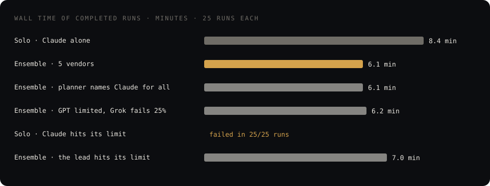

<p align="center">
  
</p>

# Ensemble

**여러 AI를 한 팀으로 일하게 만드는 Kotlin 라이브러리.** 센터가 계획하고 검수하며, 배정 시장이 일을 나눕니다. 팀원은 칠판으로 서로 알아낸 것을 공유하고, 결과는 **다른 회사의 AI**가 확인합니다. 순수 Kotlin과 코루틴만 씁니다. 프레임워크도, 안드로이드 의존도 없고 런타임 라이브러리는 두 개뿐입니다.

[English README](README.md)

```kotlin
val team = Ensemble.team {
    member(Vendor.CLAUDE, Ports.anthropic(System.getenv("ANTHROPIC_API_KEY")))
    member(Vendor.GPT, Ports.openAi(System.getenv("OPENAI_API_KEY")))
    member(Vendor.GEMINI, Ports.gemini(System.getenv("GEMINI_API_KEY")))
    member(Vendor.DEEPSEEK, Ports.deepSeek(System.getenv("DEEPSEEK_API_KEY")), lanes = 2)
    onEvent { println(it.line()) }
}

val brief = team.conduct("12월에 마감하는 디자인 공모전 세 곳을 비교해줘")   // 결과물도 한국어로
```

키가 없어도 시뮬레이션 팀으로 바로 볼 수 있습니다: `./gradlew :samples:cli:run --args="--demo"`

## 왜 '팀'인가

모델 하나로 도는 에이전트에는 지시문으로 고칠 수 없는 약점이 세 가지 있습니다.

- **사각지대가 하나.** 자기 결과를 자기가 검토하면 처음에 틀린 곳을 또 놓치기 쉽습니다.
- **한도가 하나.** 그 모델이 사용량 한도에 걸리거나 장애가 나면 작업이 멈춥니다.
- **줄이 하나.** 모든 단계가 같은 모델 뒤에서 기다립니다.

| 장치 | 하는 일 |
|---|---|
| **센터** | 계획·검수를 가장 잘하는 AI가 목표를 결과물·합격 기준·할 일로 나눕니다. 팀이 3명 이상이면 할 일을 직접 맡지 않습니다. |
| **배정 시장** | 할 일마다 팀원이 입찰합니다: `능력/10 + 0.12·지명 − 0.22·부하/레인 − 0.40·센터`. 능력에는 실제 성공률과 속도가 반영됩니다. 계획이 한 AI에게 몰아줘도 일은 퍼집니다. |
| **칠판** | 팀원이 답 끝에 `[board]` 메모(사실·결정·주의·질문)를 남깁니다. 메모는 결과물에서 떼어 내고, 뒤에 시작하는 모든 팀원에게 전달합니다. |
| **라이벌 교차 확인** | 결과가 나오면 놀고 있는 **다른 회사** AI가 뒤에서 확인합니다. 문제는 칠판에 '주의'로 올리고, 통합할 때 반드시 고치게 합니다. |
| **교체·휴식** | 빈 답·거절·한도 문구·HTTP 오류가 나면 같은 지시를 다음 적임자에게 넘깁니다. 한도에 걸린 AI는 15분 쉬고, 센터가 쓰러지면 다음 적임자가 지휘봉을 이어받습니다. |
| **승인 게이트** | 밖으로 나가는 도구(메일 등)는 사람의 '실행'이 있어야 돌아갑니다. 승인은 그 행동의 정규화 해시에 묶인 1회용 토큰이라, 받는 사람이나 본문이 바뀌면 실행되지 않습니다. |

## 두 가지 모드

- `conduct(goal)`: 몇 분짜리 일. 계획 → 동시 실행 → 빠진 곳 보강 → 통합 → 검수.
- `project(goal, minutes, dir)`: 30분~몇 시간짜리 프로젝트. 헌장 → 스프린트 → 스탠드업 → 최종 QA → 보고서. 파일마다 다른 회사 AI가 루브릭으로 채점하고, 8.0 미만이면 고칠 점과 함께 돌려보냅니다. 티켓마다 저장하므로 중간에 꺼져도 이어서 합니다.

## 벤치마크 (시뮬레이션 · 가상 시간 · 시나리오당 25회)

<p align="center"></p>

- 다섯 회사 팀이 가장 강한 모델 혼자보다 **1.4배 빠르고**, 작업 하나에 라이벌 교차 확인이 약 5번 붙습니다. 혼자 할 때는 0번입니다.
- 계획을 쓴 직후 리더가 한도에 걸려도 팀은 **25번 중 25번** 끝냅니다. 혼자서는 **25번 중 0번**입니다.
- 이 벤치마크는 모델 품질이 아니라 **지휘 방식**(시간·분배·복구)을 잽니다. 직접 돌려 보려면: `./gradlew :samples:bench:run`

## 설치

```kotlin
repositories { maven("https://jitpack.io") }
dependencies { implementation("com.github.heok0308hth-glitch:ensemble:v0.1.1") }
// 안드로이드: { exclude(group = "org.json", module = "json") }
```

## 언어

AI에게 보내는 지시문은 항상 영어입니다. 영어 지시를 가장 정확히 따르기 때문입니다. **결과물 언어는 목표 문장을 따라갑니다.** 한국어로 쓰면 한국어로, 일본어로 쓰면 일본어로 나옵니다. 언어를 고정하려면 `language = Language.KOREAN`을 씁니다.

## 출처

Ensemble은 휴대폰에서 웹·API AI 팀을 지휘하는 안드로이드 앱 [HJTK](https://github.com/heok0308hth-glitch/HJTK)의 엔진을 떼어 내 공개한 것입니다.

MIT © 2026 Heo Taehyeok
