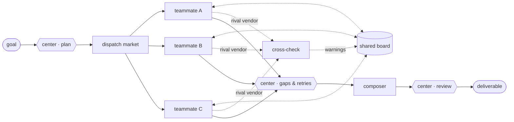
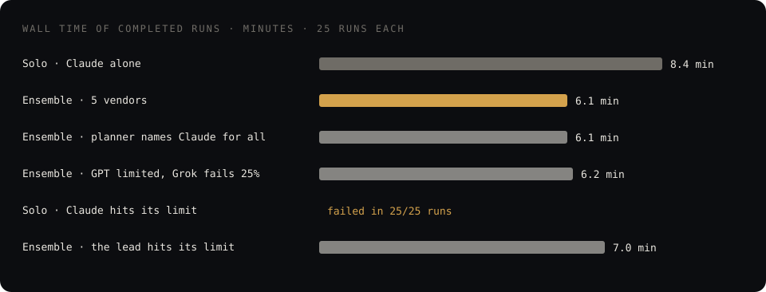

<p align="center">
  
</p>

# Ensemble

**Make several LLMs work as one team.** A center plans and reviews, a load-aware market hands out the work, a shared board keeps everyone in sync, and a model from a *different* vendor checks every result. Pure Kotlin and coroutines: no framework, no Android dependency, two runtime libraries.

[](https://github.com/heok0308hth-glitch/ensemble/actions/workflows/ci.yml)
[](https://jitpack.io/#heok0308hth-glitch/ensemble)
[](https://kotlinlang.org)
[](#install)
[](LICENSE)

```kotlin
val team = Ensemble.team {
    member(Vendor.CLAUDE, Ports.anthropic(System.getenv("ANTHROPIC_API_KEY")))
    member(Vendor.GPT, Ports.openAi(System.getenv("OPENAI_API_KEY")))
    member(Vendor.GEMINI, Ports.gemini(System.getenv("GEMINI_API_KEY")))
    member(Vendor.DEEPSEEK, Ports.deepSeek(System.getenv("DEEPSEEK_API_KEY")), lanes = 2)
    onEvent { println(it.line()) }
}

val brief = team.conduct("Compare the three biggest design competitions closing in December")
println(brief.text)
```

No keys yet? Watch a simulated five-vendor team work in your terminal:

```bash
git clone https://github.com/heok0308hth-glitch/ensemble && cd ensemble
./gradlew :samples:cli:run --args="--demo"
```

[한국어 README](README.ko.md)

---

## Why a team

A single-model agent has three weaknesses that no prompt fixes.

- **One blind spot.** A model reviewing its own work tends to miss what it got wrong the first time.
- **One quota.** When the only model hits a usage limit or an outage, the job stops.
- **One queue.** Every step waits behind the same model.

Ensemble runs models the way a small studio runs people. Each mechanism below answers one of those weaknesses, and each is a few dozen lines you can read.

## How it works



| Mechanism | What it does | Why it matters |
|---|---|---|
| **Center** | The best planner/reviewer splits the goal into a deliverable, acceptance criteria and tasks. With three or more members it takes no task itself. | Someone owns quality end to end. |
| **Dispatch market** | Every member bids on every task: `rate/10 + 0.12·named − 0.22·load/lanes − 0.40·center`. `rate` is the vendor prior bent by live success rate and latency. | The best model no longer swallows the plan. In the benchmark, a planner that names one model for *every* task still ends with the work spread across four. |
| **Shared board** | Members end replies with a short `[board]` block of facts, decisions, warnings and questions. It is stripped from the deliverable and fed to everyone who starts later. | Members that don't depend on each other still stop duplicating and contradicting each other. |
| **Rival cross-check** | When a result lands, an idle member from a *different vendor* reviews it in the background. Problems are pinned to the board as warnings that the composer must fix. | Different companies have different blind spots. |
| **Failover & benching** | Empty replies, refusals, usage-limit notices, HTTP errors and replies that merely repeat the prompt hand the same prompt to the next best idle member. Cut-off replies are continued, and nothing is graded or saved before it passes the save gate. Limit hits and auth errors bench a member for 15 minutes. If the center fails, the next best planner takes over. | A quota or an outage costs seconds, not the job. |
| **Approval gate** | Tools with outside effects need a human "yes". The action is canonicalized (RFC 8785 subset) and hashed, and the hash is sealed into a one-time HMAC token, so a changed recipient or body fails verification. | An agent can't quietly change what you approved. |

The full design, including the prompt protocol and the checkpoint format, is in [docs/architecture.md](docs/architecture.md).

## Two modes

| | `conduct(goal)` | `project(goal, minutes, dir)` |
|---|---|---|
| Scale | a few minutes | 30 minutes to several hours |
| Shape | plan → parallel tasks → gaps → compose → review | charter → sprints → stand-ups → final QA → report |
| Quality loop | rival cross-checks, one or two reviews | every file graded against a project-specific rubric by a rival; below 8.0 goes back with concrete fixes |
| Stops when | the review passes | the time budget runs out, or every file scores ≥ 9.0 and the PM agrees |
| Output | `RESULT.md` plus any code blocks as real files | a folder of files, `00_REPORT.md` with a factual work log |
| Survives a crash | — | checkpointed after every ticket to `.company.json`; call again to resume |

```kotlin
val plan = team.project(
    goal = "A go-to-market plan for a specialty coffee subscription",
    minutes = 90,
    dir = File("out/coffee"),
)
```

When the goal is an app or a game, the company builds an offline web app with its entry point at `app/index.html`. If you pass `inspect`, it opens the app, and console errors become fix tickets before delivery.

## Benchmark

<p align="center"></p>

The members are simulated: each reply takes 20–70 s, scaled by the vendor's speed. Time is virtual, so 150 seeded runs finish in seconds and reproduce exactly. This measures the **orchestrator** (wall time, how work spreads, recovery), not model quality.

- Five vendors finish **1.4× faster** than the strongest model alone, and their output carries about five rival cross-checks per job; the solo run has none.
- When the lead runs out of quota right after planning, **25 of 25** team runs still finish. The solo run finishes **0 of 25**.
- With one member rate-limited and another failing a quarter of its calls, every run completes. The cost is about six seconds.

The speedup is bounded by the plan's dependency chain and by the center's serial steps (plan, gap check, review). Ensemble says so instead of hiding it. Full table: [docs/bench.md](docs/bench.md) · run it yourself: `./gradlew :samples:bench:run`.

## Install

```kotlin
// settings.gradle.kts
dependencyResolutionManagement { repositories { mavenCentral(); maven("https://jitpack.io") } }

// build.gradle.kts
dependencies { implementation("com.github.heok0308hth-glitch:ensemble:v0.1.1") }
```

It needs JVM 17+. Its only dependencies are `kotlinx-coroutines-core` and `org.json`. On **Android**, the platform already ships `org.json`, so exclude it:

```kotlin
implementation("com.github.heok0308hth-glitch:ensemble:v0.1.1") { exclude(group = "org.json", module = "json") }
```

## Connect any model

| Port | Covers |
|---|---|
| `Ports.anthropic(key, model)` | Anthropic Messages API |
| `Ports.openAi(key, model)` | OpenAI |
| `Ports.gemini(key, model)` | Google Gemini (OpenAI-compatible endpoint) |
| `Ports.deepSeek(key)` · `Ports.grok(key)` | DeepSeek, xAI |
| `Ports.openRouter(key, "vendor/model")` | hundreds of models through OpenRouter |
| `Ports.ollama("qwen3")` | local models, fully offline |
| `Ports.openAiCompatible(name, baseUrl, key, model)` | vLLM, LM Studio, gateways, anything that speaks `/chat/completions` |
| `Ports.fn(name) { prompt -> … }` | your own function |

Ports never throw on ordinary failures. They return an empty reply and a reason (`HTTP429:…`, `ERR:…`), and the desk hands the work to someone else. Default model ids are only defaults; pass the one you use.

Two seats from the same vendor are fine (`member(Vendor.DEEPSEEK, …)` twice becomes *DeepSeek* and *DeepSeek 2*). So are several keys behind one seat: `member(v, port1, lanes = 2, port2)`.

## Watch it live

`team.stages` is a `StateFlow<Map<String, Stage>>`: who leads, the phase, every card with its owner and status, the board, and for projects the sprint, deadline, quality and files. Draw it however you like:

```kotlin
@Composable
fun Live(team: Ensemble, jobId: String) {
    val stage = team.stages.collectAsState().value[jobId] ?: return
    Column {
        Text("${stage.phase} · ${(stage.progress * 100).toInt()}%")
        stage.cards.forEach { Text("${it.who.padEnd(10)} ${it.title} — ${it.doing}") }
        stage.board.takeLast(3).forEach { Text(it) }
    }
}
```

`JobControl` pauses the job (no new requests), resumes it, or aborts it (in-flight requests are cancelled at once).

## Tools and approvals

```kotlin
val team = Ensemble.team {
    member(Vendor.CLAUDE, claude); member(Vendor.GEMINI, gemini); member(Vendor.GPT, gpt)
    tools(Toolbox {
        tool("web.search", "Search the web", Effect.READ, listOf(Param("q", "query"))) { c -> CommandResult.ok(search(c.args["q"]!!)) }
        tool("mail.send", "Send an email", Effect.EXTERNAL, listOf(Param("to", "address"), Param("body", "text"))) { c -> send(c); CommandResult.ok("sent") }
    })
    approve { req -> askTheUser(req.summary, req.warning) }   // default: reject everything
}
```

The planner sees the catalog and may put a tool in a task. If a tool fails or comes back empty, a research-strong member does the task directly. Payments are denied by policy.

## Test without keys

`Simulated` members speak the whole protocol. They take time, and they can be told to fail, hit a limit, or score lower. With `kotlinx-coroutines-test`, a 90-minute project runs in milliseconds:

```kotlin
@Test fun projectFinishes() = runTest {
    val team = Ensemble.team {
        listOf(Vendor.CLAUDE, Vendor.GPT, Vendor.GEMINI).forEach { member(it, Simulated.port(it)) }
        member(Vendor.GROK, Simulated.port(Vendor.GROK, Simulated.Profile(failRate = 0.3)))
        clock = { testScheduler.currentTime }
    }
    assertTrue(team.project("A launch plan for a pottery studio", minutes = 90).ok)
}
```

Every prompt starts with a tag such as `[ensemble:plan]` or `[ensemble:grade]` (`Prompts.kindOf(prompt)`). Runs are easy to grep, and your own test doubles can answer by role.

## Language

Instructions to the models are always English, because models follow English most reliably. The **deliverable** follows the language of the goal: a goal written in Korean gets a Korean report, and the same goes for Japanese, Chinese, Spanish, French, German and others. You can override it with `language = Language.KOREAN` or `Language.named("Vietnamese")`.

## Your own vendors

The built-in profiles (Claude, GPT, Gemini, Grok, DeepSeek, Qwen, Mistral, Llama) are honest priors, weaknesses included. Describe anything else:

```kotlin
val mine = Vendor.custom("acme", "Acme-70B", skills = mapOf(Skill.CODE to 8, Skill.WRITE to 6))
member(mine, Ports.openAiCompatible("Acme", "https://llm.acme.internal/v1", key, "acme-70b"))
```

Live performance (the `Scoreboard`) corrects the priors as the job runs. Share one scoreboard between teams to carry what it learned.

## Project layout

```
ensemble/        the library — Ensemble, Conductor, Company, CrewDesk, Board/Dispatch, aegis, tools, ports, sim
samples/cli      run a team from the terminal, with a live view
samples/bench    the orchestration benchmark and the SVGs in this README
docs/            architecture, benchmark results
```

## Where it came from

Ensemble is the engine of [HJTK](https://github.com/heok0308hth-glitch/HJTK), an Android app that runs teams of web and API models on a phone. It was split out so any Kotlin program can use it, and its prompts were rewritten in English with automatic output language.

## Roadmap

- streaming replies to the stage view
- cost-aware dispatch (price per token as a bid term)
- structured-output modes where the vendor supports JSON schemas
- Maven Central publishing

## Contributing

Issues and pull requests are welcome. [CONTRIBUTING.md](CONTRIBUTING.md) explains how to run the tests, the benchmark and the demo. Security reports go through [SECURITY.md](SECURITY.md).

## License

[MIT](LICENSE) © 2026 Heo Taehyeok. If Ensemble helps your work, a citation is appreciated ([CITATION.cff](CITATION.cff)).
